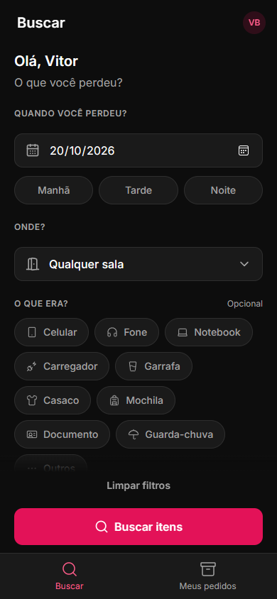
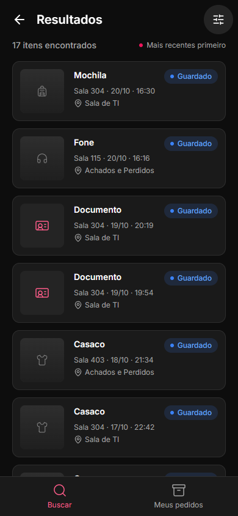
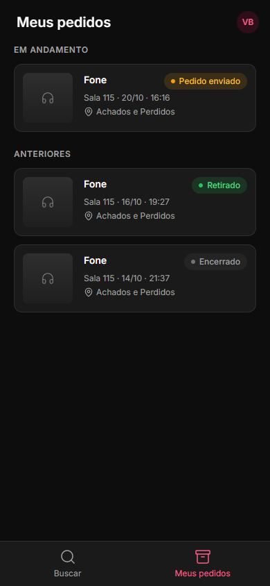
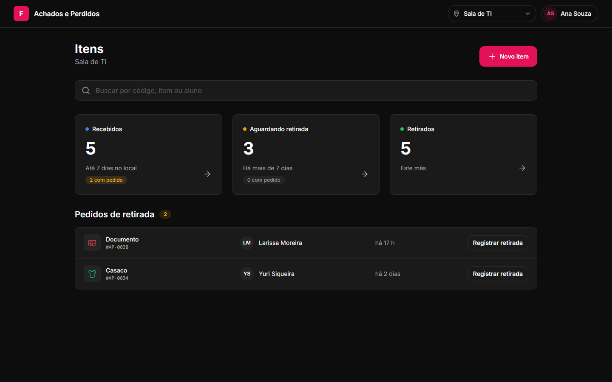
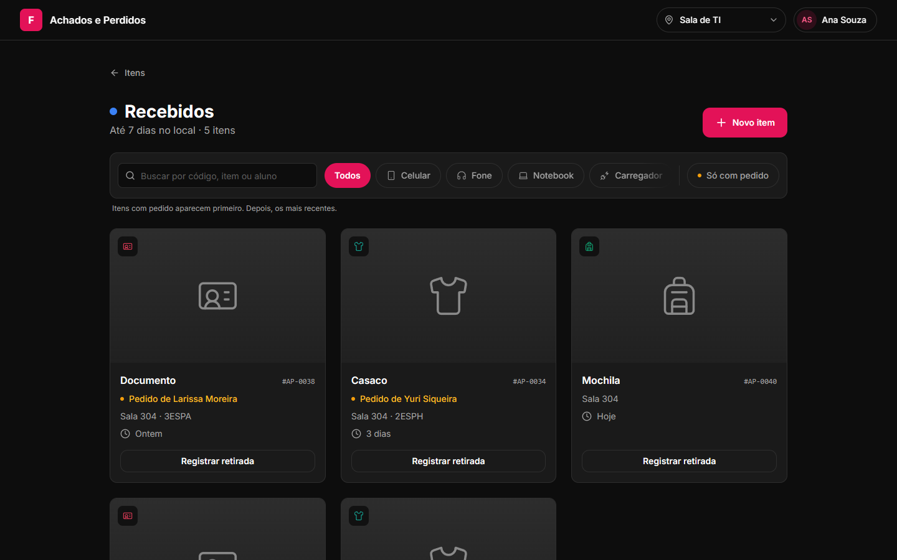
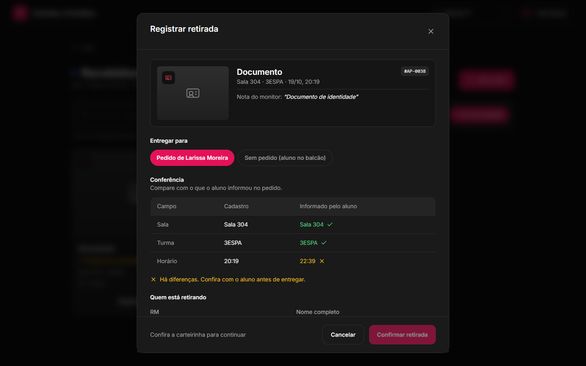
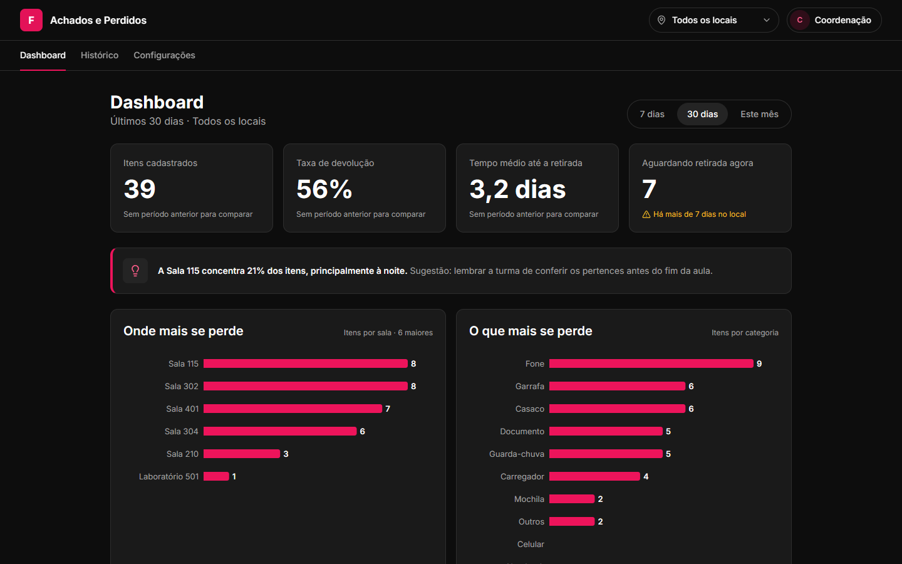

# Achados e Perdidos FIAP

Aplicação web que substitui o processo de achados e perdidos da FIAP.

**O problema.** Quando os monitores fecham as salas, encontram objetos esquecidos, tiram foto, mandam por e-mail e levam o item para o Achados e Perdidos. Depois das 22h os itens vão para a Sala de TI. Quem perdeu algo precisa ir pessoalmente perguntar, muitas vezes nos dois lugares, e **não existe registro de quem retirou cada item**.

**A solução.**

- **Monitor** (celular): cadastra o item em menos de 30 segundos, com foto, categoria, sala e local de guarda.
- **Aluno** (celular): consulta de qualquer lugar se o item foi encontrado e faz o pedido de retirada ("É meu").
- **Equipe** (desktop): registra **quem retirou** cada item, com RM, nome, carteirinha conferida, funcionário e horário. Quando há pedido, confere automaticamente sala, turma e horário.
- **Coordenação** (desktop): acompanha onde, quando e o que mais se perde, e exporta o histórico de retiradas.

Privacidade (LGPD) aplicada no banco: alunos nunca veem dados de outros alunos, e itens da categoria Documento nunca mostram a foto para alunos.

## Telas

| Aluno (celular) | | |
|---|---|---|
|  |  |  |

| Equipe e coordenação (desktop) |
|---|
|  |
|  |
|  |
|  |

As fotos dos itens nos dados de exemplo são ilustrações por categoria (`public/seed/`).

## Rodar localmente em 1 minuto

```bash
npm install
npm run dev
```

Abra [localhost:3000/login](http://localhost:3000/login). Sem Supabase configurado, o app entra em **modo demonstração**: qualquer usuário e senha funcionam, você escolhe o perfil (Aluno, Monitor, Equipe ou Gestor), e os dados são fictícios, com um mês de histórico em memória. Cadastrar, pedir, registrar e desfazer retirada funcionam de verdade; tudo volta ao início quando o servidor reinicia. O botão **"Demonstração"** no canto inferior esquerdo troca de perfil em um clique.

**Para apresentar:** `npm run demo` (versão compilada, mais rápida) e o passo a passo em [docs/roteiro-da-apresentacao.md](docs/roteiro-da-apresentacao.md).

## Ligar ao Supabase

1. Siga [docs/supabase.md](docs/supabase.md): criar o projeto, aplicar as migrations, configurar o Auth (link mágico, cadastro público desligado) e preencher o `.env.local`.
2. `npm run db:cadastros` para as salas, turmas e categorias reais (edite `scripts/cadastros/cadastros.json`), ou `npm run db:seed` para dados de exemplo.
3. `npm run dev`. Com as chaves no `.env.local`, as mesmas telas passam a usar o banco real, e o login vira link mágico no e-mail institucional.

## Deploy na Vercel

1. Importe o repositório na Vercel (framework detectado: Next.js).
2. Em **Settings > Environment Variables**, defina as variáveis do `.env.example`:
   `NEXT_PUBLIC_SUPABASE_URL`, `NEXT_PUBLIC_SUPABASE_ANON_KEY`, `SUPABASE_SERVICE_ROLE_KEY`, `ALLOWED_EMAIL_DOMAINS` e `NEXT_PUBLIC_SITE_URL` (a URL do deploy, ex.: `https://achados-fiap.vercel.app`).
3. No Supabase, em **Authentication > URL Configuration**, coloque a URL do deploy em Site URL e `https://<seu-app>.vercel.app/auth/confirmar` em Redirect URLs.
4. Deploy.

Sem as variáveis do Supabase, o deploy responde com uma mensagem de configuração em vez de funcionar pela metade. Para publicar só a **demonstração** (portfólio, dados fictícios), defina `NEXT_PUBLIC_MODO_DEMO=1` em vez das chaves.

## Scripts

| Comando | Para quê |
|---|---|
| `npm run dev` | Servidor local |
| `npm run demo` | Demonstração compilada, para apresentar (dados fictícios) |
| `npm run build` / `npm start` | Build e servidor de produção |
| `npm run lint` / `npm run typecheck` | Qualidade |
| `npm test` | Unitários + RLS + seed (Postgres em memória) |
| `npm run test:integracao` | Camada de dados contra Postgres + PostgREST reais |
| `npm run test:e2e` | Playwright no modo demonstração (fluxos, todas as telas, acessibilidade) |
| `npm run test:e2e:supabase` | Os mesmos testes com o app em modo Supabase, sem Docker |
| `npm run db:validar` | Aplica as migrations num Postgres em memória |
| `npm run db:cadastros` | Salas, turmas, locais e categorias reais no Supabase (sem apagar nada) |
| `npm run db:seed` | Dados de exemplo no Supabase (`-- --reset` recria) |

Detalhes e pré-requisitos em [docs/testes.md](docs/testes.md).

## Stack

Next.js 16 (App Router) · TypeScript strict · Tailwind CSS v4 · Supabase (Postgres, Auth com link mágico, Storage, RLS) · Zod · Server Actions · Recharts · Vitest · Playwright + axe-core.

## Como está organizado

```
src/app/                 rotas: /aluno, /monitor, /equipe, /gestor, /login, /auth
src/components/          ui (design system), itens, equipe, gestor, layout, auth
src/lib/dominio/         regras de negócio puras: status, conferência, período, local
src/lib/dados/           acesso a dados: contrato (tipos.ts), montagem compartilhada,
                         modo demonstração (demo.ts) e Supabase (supabase.ts)
src/lib/auth/            rotas por perfil, sessão, e-mail institucional
src/proxy.ts             sessão e redirecionamento por perfil
supabase/migrations/     schema, views, RLS e storage
supabase/tests/          testes de RLS, seed e integração
scripts/                 seed, harness do Postgres/PostgREST, E2E em modo Supabase
e2e/                     Playwright
design/                  DESIGN.md e referências do Google Stitch
docs/                    banco de dados, Supabase, testes
```

## Decisões que valem destacar

- **Status calculado, nunca editado.** Recebido → Aguardando retirada muda só pelo tempo (N dias, configurável). A regra existe uma vez no banco (view) e uma vez em TypeScript, com testes para as duas.
- **Retirada é auditoria.** Nunca é apagada: desfazer só marca. O banco recusa qualquer outra alteração.
- **Três barreiras de acesso:** proxy (navegação), layout de cada área (servidor) e RLS (dados). As regras de LGPD valem no banco, não só na interface.
- **Mesmas telas, duas fontes de dados.** As telas só conhecem um contrato (`Repositorio`); o modo demonstração e o Supabase usam a mesma montagem, então não divergem.
- **Testado sem Docker.** RLS num Postgres em memória (PGlite); a camada de dados e o app inteiro contra Postgres 17 + PostgREST reais.
- **Acessível.** Zero violações WCAG 2.1 A/AA no axe em todas as telas.
