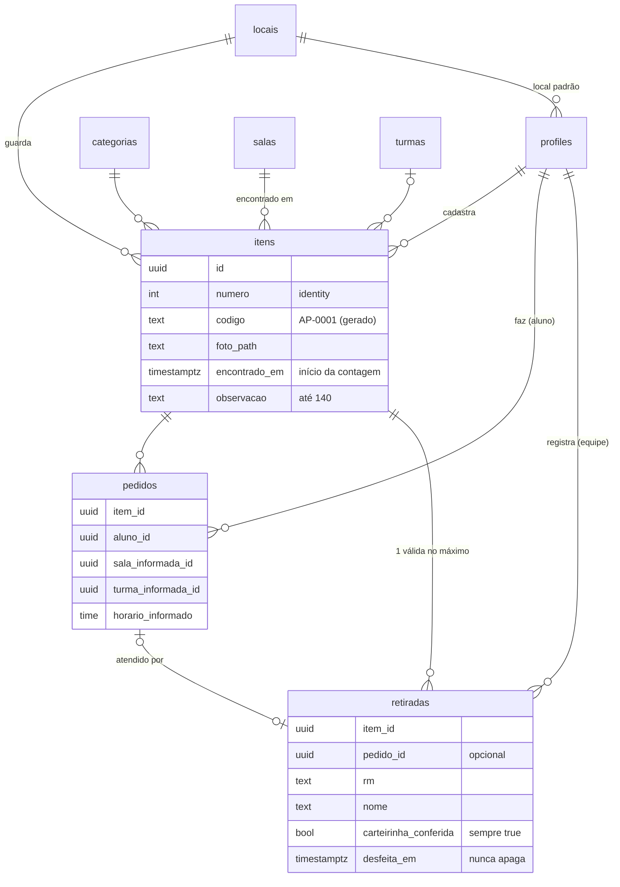

# Banco de dados

Postgres no Supabase. As migrations ficam em `supabase/migrations/` e são validadas localmente num Postgres em memória (PGlite), sem Docker:

```bash
npm run db:validar   # aplica todas as migrations e falha se alguma der erro
npm test             # inclui supabase/tests/rls.test.ts, que testa as policies como cada perfil
```

## Diagrama



## Tabelas

| Tabela | Para quê |
|---|---|
| `profiles` | Um por usuário do Auth. `role` (aluno, monitor, equipe, gestor) e `local_id` (local padrão da equipe). Criado por trigger no primeiro login, sempre como aluno. |
| `locais`, `salas`, `turmas`, `categorias` | Cadastros de apoio. `categorias.foto_sensivel` marca categorias que nunca mostram foto a alunos (Documento). |
| `configuracoes` | Linha única. `dias_para_aguardando` (padrão 7). |
| `itens` | O objeto encontrado. `codigo` é gerado a partir de uma sequência (`AP-0001`, exibido como `#AP-0001`). |
| `pedidos` | O "É meu" do aluno. Um por aluno por item; vários alunos podem pedir o mesmo item. |
| `retiradas` | Registro de auditoria da entrega. Nunca é apagado: desfazer preenche `desfeita_em`. |

## Status calculado

Nenhum status é armazenado. As views calculam a cada consulta:

| View | Quem usa | Como roda |
|---|---|---|
| `itens_com_status` | equipe, gestor, monitor | `security_invoker`: respeita o RLS de quem consulta. Traz `status`, `retirada_id` e `total_pedidos`. |
| `itens_busca` | aluno | Com privilégios do dono, mas expõe só o necessário: sem itens retirados, sem autoria, e sem foto e observação nas categorias sensíveis. |
| `meus_pedidos` | aluno | Só os pedidos de quem consulta. Status: `pendente`, `retirado` (entregue a ele) ou `encerrado` (retirado por outra pessoa, sem revelar quem). |

Regra do item: **retirado** se há retirada válida; senão **aguardando** se `encontrado_em` tem mais de N dias; senão **recebido**. A mesma regra existe em TypeScript em `src/lib/dominio/status.ts`.

## Quem pode o quê (RLS)

| | aluno | monitor | equipe | gestor |
|---|---|---|---|---|
| Ler locais, salas, turmas, categorias, configurações | ✓ | ✓ | ✓ | ✓ |
| Alterar cadastros de apoio e configurações | | | | ✓ |
| Ler o próprio perfil / todos os perfis | ✓ / | ✓ / | ✓ / ✓ | ✓ / ✓ |
| Alterar papel e local de alguém | | | | ✓ |
| Buscar itens (`itens_busca`) | ✓ | ✓ | ✓ | ✓ |
| Ler a tabela `itens` | | só os que cadastrou | ✓ | ✓ |
| Cadastrar item e enviar foto (na própria pasta) | | ✓ | ✓ | ✓ |
| Criar pedido para si, em item não retirado | ✓ | ✓ | ✓ | ✓ |
| Ler pedidos | os próprios | os próprios | ✓ | ✓ |
| Ler, registrar e desfazer retiradas | | | ✓ | ✓ |
| Apagar pedidos ou retiradas | | | | |
| Ver foto de Documento | | se enviou | ✓ | ✓ |

Usuários sem login (`anon`) não acessam nada.

## Garantias feitas no banco (não só na interface)

- **Autoria não se forja.** Triggers preenchem `cadastrado_por`, `aluno_id`, `registrado_por` e as datas a partir da sessão. O seed (service role, sem sessão) pode gravar datas passadas.
- **Uma retirada válida por item** (índice único parcial).
- **Retirada só pode ser desfeita, uma vez.** Qualquer outra alteração é recusada por trigger; `DELETE` é revogado.
- **Carteirinha conferida** é obrigatória (`check`).
- **O pedido ligado a uma retirada é do mesmo item** (FK composta).
- **Papel e local** só mudam pelo gestor (trigger em `profiles`).
- **RM pelo e-mail.** E-mails `rm123456@fiap.com.br` já preenchem o RM no primeiro login.

## Fotos (Storage)

Bucket privado `itens`, até 5 MB, WebP/JPEG/PNG. Caminho: `<id de quem enviou>/<uuid>.webp`. As URLs são assinadas no servidor; as policies de `storage.objects` repetem a regra de LGPD (foto de categoria sensível só para equipe, gestor e quem enviou).
